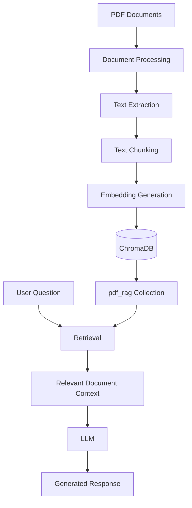

# PDF RAG – Local Document Knowledge Base

## Overview

This project documents my implementation of a Retrieval-Augmented Generation (RAG) based document knowledge system using ChromaDB as the vector database.

The objective is to create a searchable knowledge base from PDF documents and make document information available for retrieval by AI applications.

Instead of relying only on the general knowledge of an LLM, RAG allows an application to retrieve relevant information from a dedicated document collection and use that information as context when generating responses.

The project is part of my personal Home Lab and Local AI environment.

## Project Objectives

- Build a searchable knowledge base from PDF documents.
- Store document embeddings in a vector database.
- Use semantic search to retrieve relevant document content.
- Create a foundation for integrating local LLMs.
- Experiment with Retrieval-Augmented Generation (RAG).
- Explore the use of private, self-hosted document knowledge bases.
- Make document information accessible to compatible AI applications.

## Technology Stack

| Technology | Purpose |
|---|---|
| ChromaDB | Vector database |
| PDF Documents | Knowledge sources |
| RAG | Document retrieval and AI context |
| Local AI Environment | LLM integration environment |
| Ollama | Local LLM runtime used in the broader AI lab |

Note: The exact PDF extraction library, embedding model, document chunking configuration, and LLM connection used by this implementation are yet to be documented.

## Project Implementation

### 1. Vector Database

ChromaDB is used to store and manage the vector records associated with the document knowledge base.

The configured collection is:

```text
Collection Name: pdf_rag
```

At the last recorded check, the collection contained approximately:

```text
Collection: pdf_rag
Record Count: 9,215
```

The record count represents entries stored in the vector collection. It should not be interpreted as the number of original PDF documents.

### 2. RAG Architecture

The intended document retrieval workflow consists of the following stages:

1. PDF documents are provided as knowledge sources.
2. Document content is extracted.
3. Extracted content is divided into smaller chunks.
4. Text chunks are converted into vector embeddings.
5. Embeddings and associated document information are stored in ChromaDB.
6. A user submits a question.
7. Relevant document content is retrieved from the vector database.
8. Retrieved information can be supplied to an LLM to generate a context-aware response.

### Architecture Diagram



This illustrates the RAG workflow. The exact implementation of each processing and inference component will be documented as the configuration is verified.

## Vector Database Details

| Parameter | Value |
|---|---|
| Database | ChromaDB |
| Collection | pdf_rag |
| Last observed record count | Approximately 9,215 |
| Data type | Document-related vector records |
| Primary purpose | Semantic document retrieval |

The collection can be inspected to verify its current record count and metadata.

## Integration with Local AI

This project is designed to complement the Local AI Environment.

The broader AI environment includes:

- Ollama running on Linux Mint.
- Qwen3:4b.
- Ollama running on an Ubuntu VM hosted on Proxmox.
- Llama 3.2:3b.

These local models provide potential inference backends for a RAG application.

The exact model used for document question answering and its connection to ChromaDB will be documented after verification.

## Potential Use Cases

- Searching information across multiple PDF documents.
- Building a personal technical documentation knowledge base.
- Retrieving relevant information from manuals and technical references.
- Exploring AI-assisted document analysis.
- Creating a self-hosted knowledge assistant.
- Supporting future AI automation workflows.

## Validation and Monitoring

The following checks are useful when maintaining the knowledge base:

- Confirm that the ChromaDB service is accessible.
- Verify that the `pdf_rag` collection exists.
- Check the current collection record count.
- Confirm that document metadata is available.
- Test retrieval using representative questions.
- Verify that retrieved content relates to the original source documents.

## Security and Privacy

This project is intended to be documented in a public GitHub repository.

The repository should contain documentation, configuration examples, and sanitized scripts only.

Do not upload:

- Private PDF documents.
- Confidential business or financial documents.
- Personal or sensitive information.
- Database files containing actual private document content.
- API keys, passwords, tokens or credentials.
- Private network configurations.

Use synthetic or public-domain sample documents for demonstrations.

## Future Improvements

- Document the actual PDF extraction pipeline.
- Document the embedding model and configuration.
- Document text chunking and metadata strategies.
- Add a reproducible document ingestion script.
- Implement and document semantic search.
- Integrate ChromaDB with a local LLM.
- Build a simple document question-answering interface.
- Add retrieval accuracy and performance testing.
- Implement source-document attribution in generated responses.
- Add backup and restore procedures for the vector database.

## Suggested Repository Structure

```text
pdf-rag-knowledge-base/
│
├── README.md
│
├── documentation/
│   ├── architecture.md
│   ├── installation.md
│   ├── document-ingestion.md
│   ├── vector-database.md
│   └── troubleshooting.md
│
├── scripts/
│   └── README.md
│
├── examples/
│   └── README.md
│
└── screenshots/
    └── README.md
```

## Learning Outcomes

Through this project, I have worked with:

- Vector databases.
- ChromaDB collections.
- Document knowledge-base architecture.
- Retrieval-Augmented Generation concepts.
- Local AI infrastructure.
- Integration possibilities between vector databases and LLMs.

## Disclaimer

This is a personal home lab project intended for learning, experimentation, and research.

Implementation details, dependencies, and configurations may evolve as the project develops.
